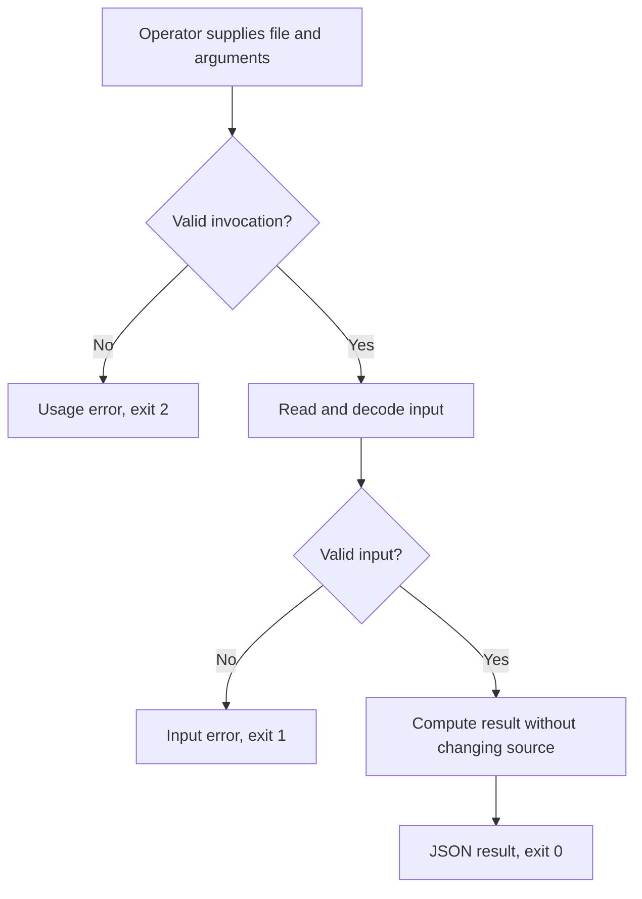

# CSV Total Lite PRD

## 1. Overview

### Layer 1: Human PRD

Existing-product repair for an expense export CLI. Preserve the input/output interface while supporting real CSV quoting and exact decimal totals.

Scope: One UTF-8 CSV file with exact item,amount header, two fields per record, quoted commas/newlines/doubled quotes, optional BOM, LF/CRLF and optional final line ending. Excludes spreadsheet formula evaluation, currency conversion, UI, network and modifying exports.

Decisions: standard-library implementation and a single process fit a local,
read-only CLI. Fixed input/output examples define correctness; no model output
or structure score substitutes for runtime checks. Use Lite because there is no
product UI. N/A - external research is unnecessary for these settled file contracts.
Proposed implementation commands and runtime behavior remain UNVERIFIED until built.

### Layer 2: Machine Spec

Manual argv invocation reads a local file and returns stdout JSON or stderr plus
an exit code. candidate.mjs owns argument parsing, decoding, transformation and
rendering. The fixed case.json contains isolated inputs and independent expected
outputs. No credentials, accounts, providers, persistent state or scheduler exist.

## 2. Requirements

### Review Focus

N/A - the evaluation brief resolves the local interface and acceptance boundary.
Final owner acceptance and deployment are outside this trial.

| ID | Requirement | Priority | Acceptance Criteria IDs |
|---|---|---|---|
| FR-001 | Preserve invocation and the successful rows/total JSON interface for ordinary exports. | Must | AC-001 |
| FR-002 | Parse the CSV input grammar below, including quoted fields, and reject malformed records and headers. | Must | AC-002 |
| FR-003 | Sum signed decimal amounts exactly as integer cents and format exactly two places without negative zero. | Must | AC-003 |
| FR-004 | Reject bad arguments, unreadable inputs and invalid CSV with the exact errors below. | Must | AC-004 |
| NFR-001 | Preserve source bytes, create no files or network requests and use Node.js 20+ standard modules only. | Must | AC-005 |

### Acceptance Criteria

| ID | Requirement IDs | Type | Observable Criterion | Required Evidence |
|---|---|---|---|---|
| AC-001 | FR-001 | Positive | Hosting 19.90 and Storage 0.10 yield rows 2 and total 20.00 with exit 0, one JSON object plus LF and empty stderr. | ordinary-export |
| AC-002 | FR-002 | Positive/Negative | Quoted comma yields 20.00; a quoted multiline description with escaped quotes and a refund yields 2.00; BOM header-only yields rows 0 and total 0.00. Malformed quoting, headers and field counts fail. | CSV grammar cases and additional parser boundary checks |
| AC-003 | FR-003 | Boundary | 9007199254740992.01 plus 0.09 yields 9007199254740992.10; -0.10 plus 0.1 yields 0.00. Reject excess precision, NaN, formulas, whitespace and exponent amounts. | Exact arithmetic and rejected-decimal cases |
| AC-004 | FR-004 | Negative | Wrong argument count exits 2 with Invalid arguments plus LF. Unreadable/non-file/invalid-UTF-8 input exits 1 with Cannot read input plus LF. Invalid CSV exits 1 with Invalid CSV plus LF. Error stdout is empty. | Error cases plus native UTF-8/non-file checks |
| AC-005 | NFR-001 | Invariant | Every invocation preserves input bytes and creates no paths; source contains no network calls or dependencies. | Evaluator preservation checks and source review |

### Change Contract

Current evidence: the preserved before.mjs uses split-on-comma parsing and Number
summation. Running the frozen 14-case suite on 2026-11-03 passed 5 and failed 9.
The quoted-comma reproducer emitted total NaN instead of 20.00. Large amounts
lost precision; malformed CSV was accepted. Cause is confirmed by source and
those reproductions. No production application or customer dataset was inspected.

Requested change: FR-002 through FR-004 repair parsing, arithmetic and errors.
Preserve FR-001 invocation and JSON keys, ordinary totals, usage/missing-input
errors and NFR-001 input bytes. No prior PRD existed for this fixture; IDs below
are new specification identities, not a retroactive claim of an approved baseline.
The unchanged suite compares changed and preserved behavior; retain before.mjs.

| ID | Status | Note |
|---|---|---|
| FR-001 | added | Specify the existing CLI interface to preserve |
| FR-002 | added | Specify corrected CSV parsing |
| FR-003 | added | Specify exact decimal arithmetic |
| FR-004 | added | Specify consistent negative outcomes |
| NFR-001 | added | Specify preservation and local runtime constraints |

No historical IDs or retirement records existed; none are removed or reused.

### Constraints

N/A - authentication, secrets, replay, retries and cloud deployment are absent in
this read-only single invocation. Run only trusted local candidate code. The
fixture budget is 1 MiB per input; large streaming workloads are outside this
example. The evaluator gives each process 3000 ms and removes temporary files.
Duplicate invocations read unchanged data and produce the same result.

## 3. Architecture & Data Flow

### Data Contracts

`node candidate.mjs <csv-file>`. JSON output is `{"rows":2,"total":"20.00"}`
for the ordinary example. Header fields must equal `item` and `amount` exactly.
Every data record has two fields. CSV quoting opens only at the start of a field,
doubled quotes escape a quote, and a closing quote is followed only by comma,
line ending or EOF. LF and CRLF terminate records; a bare CR outside quotes is
invalid. Quoted newlines are part of the item value. A final record separator is
not an extra empty record. An empty file is invalid; header-only is valid.

Amounts match an optional minus, one or more digits, and optionally a decimal
point followed by one or two digits. No whitespace, exponents or formulas.
Use integer cents with arbitrary precision, including values beyond safe Number
integers. Descriptions are inert strings. UTF-8 decoding is strict; a BOM may
precede the header. All failures use the exact stderr and exit contracts above.

### Builder Capability Routing Contract

Act on the current request: a PRD alone does not authorize building. At startup,
read this PRD and target instructions once; inspect the host-provided available
skill/tool catalog, read matching instructions, and check prerequisites.
Record chosen routes, UNAVAILABLE preferences, affected IDs, and evidence limits
in PROGRESS.md and the audit. Names do not authorize installation or host/model
changes; use declared repository-native fallbacks.

For new native builds, the explicit build request authorizes scoped local work.
Use this PRD's outcome milestones and coverage in PROGRESS.md; show the plan and
continue without another routine approval. Make the core path runnable early,
complete the requested scope and visual quality, and preserve unrelated work.
Set status to implementation at build start; advance current_milestone only
after required evidence passes. Component steps stay internal checklists.

Existing toolkit TASKS.json/.prd/task-state.json or an explicit runner request
requires the actual runner and its guide. Preserve exact plan approval and
failure rules; never bypass failure, PLAN_CHANGED, missing runner access, or
state conflicts by switching modes. Native builds need no toolkit installation.

Read relevant changed files on continuation, not the whole project per step.
Keep a concise resume delta in PROGRESS.md: current milestone, changed paths,
checks/results, unresolved IDs, and next action. Recheck affected dependencies
when source, requirements, environment, or route evidence changes. Do not repeat
unchanged discovery, regenerate the PRD, or rerun unrelated suites per file.

Use targeted checks while building; diagnose failures before bounded retries.
Fallbacks never weaken ACs or turn mocks/unperformed manual checks into live
proof. Continue independent safe work, keeping dependent IDs UNVERIFIED.
Pause for blocking decisions, material scope changes, or a genuine new authority boundary: external
writes, destructive actions, purchases, credentials, deployment, production,
or owner acceptance—not ordinary milestone transitions.

Finish with full applicable regression, the intended user path and material
failure/boundary tests; repair in-scope defects and rerun affected checks.
IMPLEMENTATION_AUDIT.md must cover every FR/NFR/AC: expected behavior, surface,
source-state identity, exact checks/results, real-versus-mocked evidence,
VERIFIED/PARTIAL/NOT_IMPLEMENTED/UNVERIFIED status, and limitations.
Completion requires all implementation-scoped requirements/checks to pass.
After each milestone report outcome, grouped changes, exact trial instructions,
verification, limits, progress, and next action; continue covered work automatically.
Deployment and final owner acceptance are separate claims.

| Trigger | Required capability | Preferred skill/tool if available | Fallback if unavailable | Required evidence | Authority |
|---|---|---|---|---|---|
| Implement and exercise local CLI | Filesystem inspection and process execution | Host terminal and Node.js if available after inspecting host tools | Run the documented Node commands manually; otherwise leave runtime UNVERIFIED | Exact outputs, exits, source hashes and preserved inputs | Scoped local implementation only after explicit build request |

## 4. Implementation & Milestones

| # | Milestone | Implementation Tasks | Done When | Status |
|---|---|---|---|---|
| 1 | Usable local command | Implement all specified input/output contracts; run focused positive and error trials | The command runs and focused cases pass | ⬜ Not Started |
| 2 | Integrated qualification | Run full fixed suite and real CLI failure/boundary tests; inspect source, fix defects and rerun affected checks | Every FR/NFR/AC has source and passing required evidence in the implementation audit | ⬜ Not Started |

### Authority Policy v1

For a new native build, the user's explicit build request authorizes scoped local implementation.

One exact plan approval covers declared local runner transitions.

Pause only for a blocking decision, material scope change, or a genuine new authority boundary: external writes, destructive actions, purchases, credential changes, deployment, production, or owner acceptance.

### Runtime Checks

In an isolated target directory with Node.js 20+, use
`node candidate.mjs input.txt` (CSV uses `input.csv`) after creating representative
input from the requirements. For the fixed suite run from the toolkit checkout:
`node scripts/prd.mjs evaluate evals/real-cases/csv-total/case.json --json -- node /absolute/path/to/candidate.mjs`.
These are proposed checks, not executed evidence. The candidate path is absolute
because each case gets a fresh temporary working directory. The evaluator removes
its temporary fixtures and hashes the case and entry file; additional imported
source must be recorded separately. No browser, server or provider smoke applies.
Test invalid UTF-8 and non-file inputs using native process tests as well.

## 5. Risks

| Risk | Probability | Impact | Mitigation | Owner |
|---|---|---|---|---|
| Boundary behavior differs from contract | Medium | Wrong result or silent acceptance | Fixed expected values and negative CLI checks | Builder |
| Example treated as universal proof | Medium | Unsupported confidence | State case/environment bounds and preserve raw receipts | Maintainer |

### Failure Modes

Argument and file/format failures return the exact error contracts with no writes.
Correct the input and invoke again; there is no automatic retry or hidden recovery.
A failing evaluator case prevents a completion claim for its affected requirement.

## 6. Progress

The milestones above own Done When; PROGRESS.md records live verification and
resume evidence. Draft generation leaves both milestones unstarted. Only actual
owner approval means Approved. Required gaps stay UNVERIFIED. Final audit covers
every requirement and acceptance criterion with source and actual runtime evidence.

### Traceability Matrix

| Capability | FR/NFR IDs | AC IDs | Input | Output | Runtime Component | Milestone | Required Evidence |
|---|---|---|---|---|---|---|---|
| CSV export repair | FR-001, FR-002, FR-003, FR-004, NFR-001 | AC-001, AC-002, AC-003, AC-004, AC-005 | CSV file and argv | JSON or stderr/exit | candidate.mjs | 1, 2 | Unchanged case suite on baseline and repaired implementation, parser boundaries and source review |
