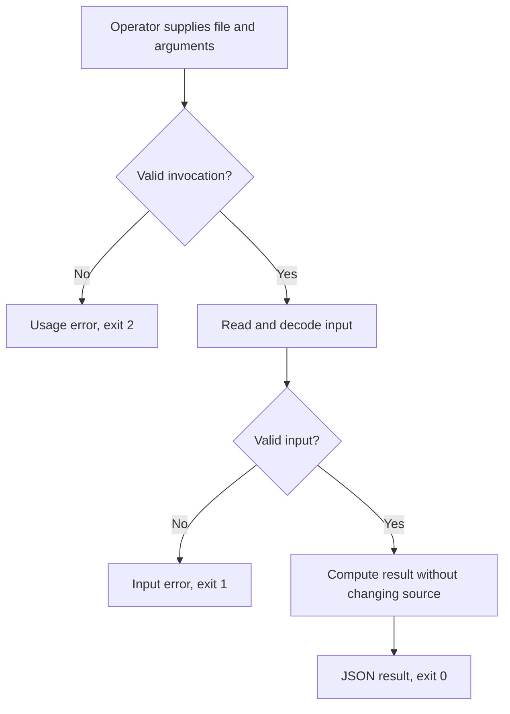

# Line Summary Lite PRD

## 1. Overview

### Layer 1: Human PRD

New tool for developers inspecting exported text notes; one read-only command reports line counts and literal matches.

Scope: One file, optional literal filter, JSON output and explicit errors. Excludes network, UI, recursion, write-back and model calls.

Decisions: standard-library implementation and a single process fit a local,
read-only CLI. Fixed input/output examples define correctness; no model output
or structure score substitutes for runtime checks. Use Lite because there is no
product UI. N/A - external research is unnecessary for these settled file contracts.
Proposed implementation commands and runtime behavior remain UNVERIFIED until built.

### Layer 2: Machine Spec

Manual argv invocation reads a local file and returns stdout JSON or stderr plus
an exit code. candidate.mjs owns argument parsing, decoding, transformation and
rendering. The fixed case.json contains isolated inputs and independent expected
outputs. No credentials, accounts, providers, persistent state or scheduler exist.

## 2. Requirements

### Review Focus

N/A - the evaluation brief resolves the local interface and acceptance boundary.
Final owner acceptance and deployment are outside this trial.

| ID | Requirement | Priority | Acceptance Criteria IDs |
|---|---|---|---|
| FR-001 | Count LF/CRLF text lines, excluding a final terminator from the count, and count non-whitespace lines. Empty files have zero lines. | Must | AC-001 |
| FR-002 | With --contains, count case-sensitive literal substring matches per line, including Unicode and metacharacters; empty literal matches every line. Without it, matching is null. | Must | AC-002 |
| FR-003 | Accept exactly a file argument and optionally --contains followed by a literal. Return exact success/error contracts below. | Must | AC-003 |
| NFR-001 | Preserve all input bytes; create no output files or network requests. Use Node.js 20+ with standard modules only. | Must | AC-004 |

### Acceptance Criteria

| ID | Requirement IDs | Type | Observable Criterion | Required Evidence |
|---|---|---|---|---|
| AC-001 | FR-001 | Positive/Boundary | For alpha, blank, beta with a final LF, emit lines 3 and non_empty 2; empty input is 0/0; a single LF is 1/0; CRLF gives equivalent counts. | Fixed case notes-with-blanks, empty-file, one-empty-line, windows-newlines |
| AC-002 | FR-002 | Positive/Boundary | Cat matches one of Cat/cat/CAT; 猫 matches two lines of the Unicode example; $(echo x).* is literal; empty filter matches all three lines of a/blank/b. | Fixed literal/filter cases |
| AC-003 | FR-003 | Positive/Negative | Success emits one JSON object plus LF with exit 0 and empty stderr. Bad arguments exit 2 with Invalid arguments plus LF; bad input exits 1 with Cannot read input plus LF, both with empty stdout. | Case error paths plus invalid-UTF-8 native process check |
| AC-004 | NFR-001 | Invariant | Each invocation preserves input bytes and leaves no additional files; no network or dependency APIs appear in source. | Evaluator file checks and source review |

### Constraints

N/A - authentication, secrets, replay, retries and cloud deployment are absent in
this read-only single invocation. Run only trusted local candidate code. The
fixture budget is 1 MiB per input; large streaming workloads are outside this
example. The evaluator gives each process 3000 ms and removes temporary files.
Duplicate invocations read unchanged data and produce the same result.

## 3. Architecture & Data Flow

### Data Contracts

`node candidate.mjs <file> [--contains <literal>]`. Output keys are `lines`,
`non_empty`, `matching`; the last is null when no filter was requested. UTF-8 is
strictly decoded; reject directories and unreadable/missing files. LF separates
lines and a preceding CR belongs to its CRLF terminator. Remove exactly one
terminal LF before splitting; blank and whitespace-only lines remain lines.
The filter can be an empty string. No regex or shell interpretation is permitted.

### Builder Capability Routing Contract

Act on the current request: a PRD alone does not authorize building. At startup,
read this PRD and target instructions once; inspect the host-provided available
skill/tool catalog, read matching instructions, and check prerequisites.
Record chosen routes, UNAVAILABLE preferences, affected IDs, and evidence limits
in PROGRESS.md and the audit. Names do not authorize installation or host/model
changes; use declared repository-native fallbacks.

For new native builds, the explicit build request authorizes scoped local work.
Use this PRD's outcome milestones and coverage in PROGRESS.md; show the plan and
continue without another routine approval. Make the core path runnable early,
complete the requested scope and visual quality, and preserve unrelated work.
Set status to implementation at build start; advance current_milestone only
after required evidence passes. Component steps stay internal checklists.

Existing toolkit TASKS.json/.prd/task-state.json or an explicit runner request
requires the actual runner and its guide. Preserve exact plan approval and
failure rules; never bypass failure, PLAN_CHANGED, missing runner access, or
state conflicts by switching modes. Native builds need no toolkit installation.

Read relevant changed files on continuation, not the whole project per step.
Keep a concise resume delta in PROGRESS.md: current milestone, changed paths,
checks/results, unresolved IDs, and next action. Recheck affected dependencies
when source, requirements, environment, or route evidence changes. Do not repeat
unchanged discovery, regenerate the PRD, or rerun unrelated suites per file.

Use targeted checks while building; diagnose failures before bounded retries.
Fallbacks never weaken ACs or turn mocks/unperformed manual checks into live
proof. Continue independent safe work, keeping dependent IDs UNVERIFIED.
Pause for blocking decisions, material scope changes, or a genuine new authority boundary: external
writes, destructive actions, purchases, credentials, deployment, production,
or owner acceptance—not ordinary milestone transitions.

Finish with full applicable regression, the intended user path and material
failure/boundary tests; repair in-scope defects and rerun affected checks.
IMPLEMENTATION_AUDIT.md must cover every FR/NFR/AC: expected behavior, surface,
source-state identity, exact checks/results, real-versus-mocked evidence,
VERIFIED/PARTIAL/NOT_IMPLEMENTED/UNVERIFIED status, and limitations.
Completion requires all implementation-scoped requirements/checks to pass.
After each milestone report outcome, grouped changes, exact trial instructions,
verification, limits, progress, and next action; continue covered work automatically.
Deployment and final owner acceptance are separate claims.

| Trigger | Required capability | Preferred skill/tool if available | Fallback if unavailable | Required evidence | Authority |
|---|---|---|---|---|---|
| Implement and exercise local CLI | Filesystem inspection and process execution | Host terminal and Node.js if available after inspecting host tools | Run the documented Node commands manually; otherwise leave runtime UNVERIFIED | Exact outputs, exits, source hashes and preserved inputs | Scoped local implementation only after explicit build request |

## 4. Implementation & Milestones

| # | Milestone | Implementation Tasks | Done When | Status |
|---|---|---|---|---|
| 1 | Usable local command | Implement all specified input/output contracts; run focused positive and error trials | The command runs and focused cases pass | ⬜ Not Started |
| 2 | Integrated qualification | Run full fixed suite and real CLI failure/boundary tests; inspect source, fix defects and rerun affected checks | Every FR/NFR/AC has source and passing required evidence in the implementation audit | ⬜ Not Started |

### Authority Policy v1

For a new native build, the user's explicit build request authorizes scoped local implementation.

One exact plan approval covers declared local runner transitions.

Pause only for a blocking decision, material scope change, or a genuine new authority boundary: external writes, destructive actions, purchases, credential changes, deployment, production, or owner acceptance.

### Runtime Checks

In an isolated target directory with Node.js 20+, use
`node candidate.mjs input.txt` (CSV uses `input.csv`) after creating representative
input from the requirements. For the fixed suite run from the toolkit checkout:
`node scripts/prd.mjs evaluate evals/real-cases/line-summary/case.json --json -- node /absolute/path/to/candidate.mjs`.
These are proposed checks, not executed evidence. The candidate path is absolute
because each case gets a fresh temporary working directory. The evaluator removes
its temporary fixtures and hashes the case and entry file; additional imported
source must be recorded separately. No browser, server or provider smoke applies.
Test invalid UTF-8 and non-file inputs using native process tests as well.

## 5. Risks

| Risk | Probability | Impact | Mitigation | Owner |
|---|---|---|---|---|
| Boundary behavior differs from contract | Medium | Wrong result or silent acceptance | Fixed expected values and negative CLI checks | Builder |
| Example treated as universal proof | Medium | Unsupported confidence | State case/environment bounds and preserve raw receipts | Maintainer |

### Failure Modes

Argument and file/format failures return the exact error contracts with no writes.
Correct the input and invoke again; there is no automatic retry or hidden recovery.
A failing evaluator case prevents a completion claim for its affected requirement.

## 6. Progress

The milestones above own Done When; PROGRESS.md records live verification and
resume evidence. Draft generation leaves both milestones unstarted. Only actual
owner approval means Approved. Required gaps stay UNVERIFIED. Final audit covers
every requirement and acceptance criterion with source and actual runtime evidence.

### Traceability Matrix

| Capability | FR/NFR IDs | AC IDs | Input | Output | Runtime Component | Milestone | Required Evidence |
|---|---|---|---|---|---|---|---|
| Text inspection | FR-001, FR-002, FR-003, NFR-001 | AC-001, AC-002, AC-003, AC-004 | File and argv | JSON or stderr/exit | candidate.mjs | 1, 2 | Fixed behavioral suite, UTF-8 check and source inspection |
